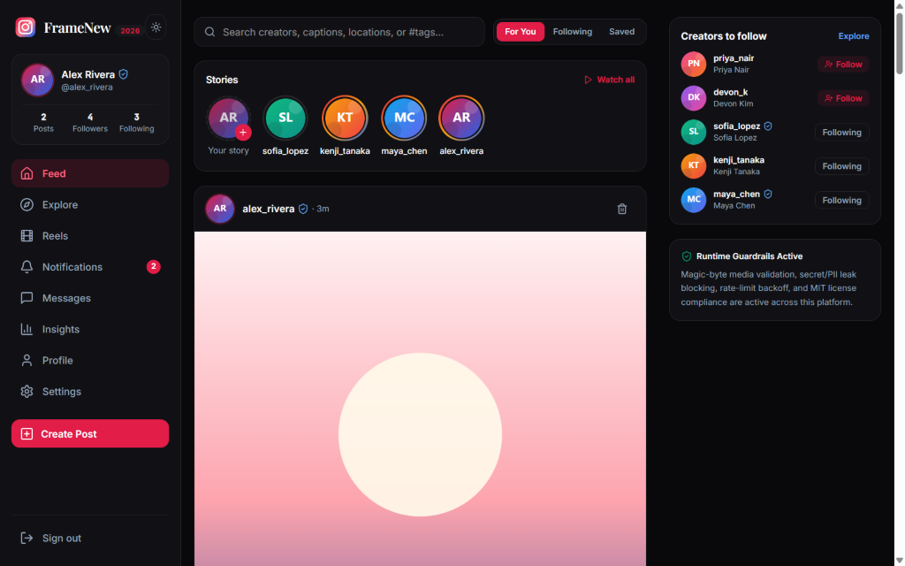
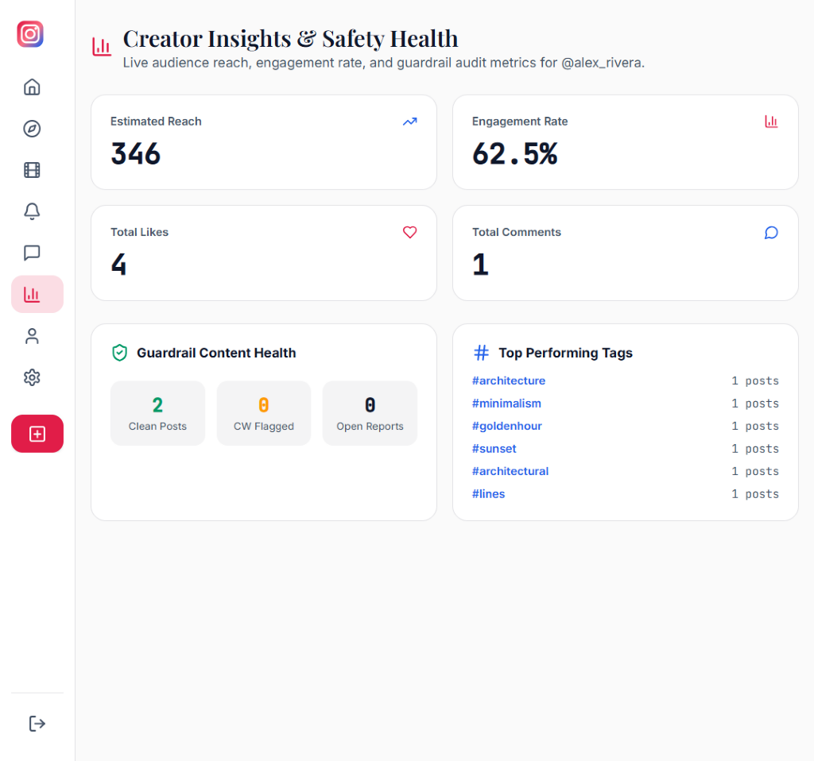

# FrameNew (`instagram-clone-project-new`)

Modern 2026 **MERN / Full-Stack TypeScript** visual social, stories, reels, and creator feed platform — upgraded from a static 2023 CodeSandbox template into a production-structured, MIT-licensed end-to-end application with runtime security guardrails.

> **Disclaimer**: FrameNew is an independent open-source educational clone and is not affiliated with or endorsed by Meta Platforms, Inc. or Instagram. See [`LICENSING.md`](LICENSING.md) for asset provenance and trademark hygiene.

## Preview
| Dark Mode — Feed, Stories & Guardrail Card | Light Mode — Creator Insights & Safety Health |
| :---: | :---: |
|  |  |

<details>
<summary>Included MIT-Licensed Editorial Sample Media (<code>client/public/media/</code>)</summary>

| Minimalist Arches | Specialty Coffee | Alpine Ridges | Rainy Lantern Lane |
| :---: | :---: | :---: | :---: |
|  |  |  |  |

</details>

## Stack Architecture (MERN + Zero-Config Local Persistence)
- **Frontend (`client/`)**: React 19, TypeScript, Vite 6, Tailwind CSS v4, React Router 7, Lucide Icons, DOMPurify.
- **Backend (`server/`)**: Node.js 24 LTS, Express 5, TypeScript, Zod, Helmet, Express Rate Limit, Multer 2, JWT + Bcryptjs.
- **Database Layer (`server/src/db/`)**:
  - **MongoDB + Mongoose** (`MONGODB_URI` set, or `docker compose up -d` via [`docker-compose.yml`](docker-compose.yml)) for full MERN mode.
  - **Zero-config Embedded SQLite (`node:sqlite`)** when `MONGODB_URI` is empty — starts and persists immediately on `npm run dev` with seeded creators, posts, reels, stories, DMs, and notifications.

## Features
- **Authentication & Demo Switcher**: Register, sign in with JWT, or launch instantly via 1-click demo accounts (`@alex_rivera`, `@maya_chen`).
- **Feed, Stories & Reels**: Interactive 24h Stories viewer with keyboard navigation & DM replies, double-tap heart likes, bookmarks, threaded comments, hashtag filtering, and vertical Reels showcase.
- **Create Studio + 2026 AI Caption & Alt-Text Assist**: Upload JPEG/PNG/WebP images (up to 5 MB) or select MIT studio presets, generate accessible alt text and captions via `/api/ai/caption-assist`, and preview live guardrail checks before posting.
- **Direct Messages, Notifications & Creator Insights**: Persistent 1-to-1 DMs, activity notifications, creator profile editing, follow/unfollow, and an Insights dashboard tracking reach, engagement rate, and guardrail content health.

## Security & Safety Guardrails
1. **Binary Magic-Byte Upload Verification** (`server/src/guardrails/uploadGuard.ts`): Validates JPEG, PNG, and WebP headers so disguised HTML/SVG/JS scripts cannot be uploaded.
2. **Secret, PII & Anti-Spam Detection** (`server/src/guardrails/contentGuard.ts`): Blocks credential leaks (`ghp_`, `AKIA`, `sk-`, private keys, SSNs), link/hashtag floods, HTML injection, and unsafe URL schemes (`javascript:`, `data:`).
3. **Sliding-Window Rate Limiting & Bounded Client Backoff** (`server/src/guardrails/rateLimiters.ts` & `client/src/lib/apiClient.ts`): Enforces `429` limits with `Retry-After` headers and bounded client retry/backoff.
4. **Content Warnings & Moderation Reporting**: Auto-flags sensitive topics with click-to-reveal media blur and lets users file safety reports.
5. **Automated License Compliance Audit** (`scripts/check-licenses.mjs`): Enforces permissive OSS dependencies across root, `server`, and `client`.

## Quickstart

```bash
# 1. Install all dependencies (root, server, client)
npm run install:all

# 2. Start Express API (port 5000) + Vite React UI (port 5173)
npm run dev

# 3. Optional: run with MongoDB 8 via Docker
docker compose up -d
# Then set MONGODB_URI=mongodb://localhost:27017/framenew in .env
```

## Verification Commands

```bash
npm run typecheck       # TypeScript checks for server & client
npm run lint            # ESLint checks on client
npm run check:licenses  # OSS dependency license compliance audit
npm test                # Vitest unit + Supertest API integration tests
npm run build           # Production server compile + Vite client bundle
npm run verify          # Runs all checks above in sequence
```
